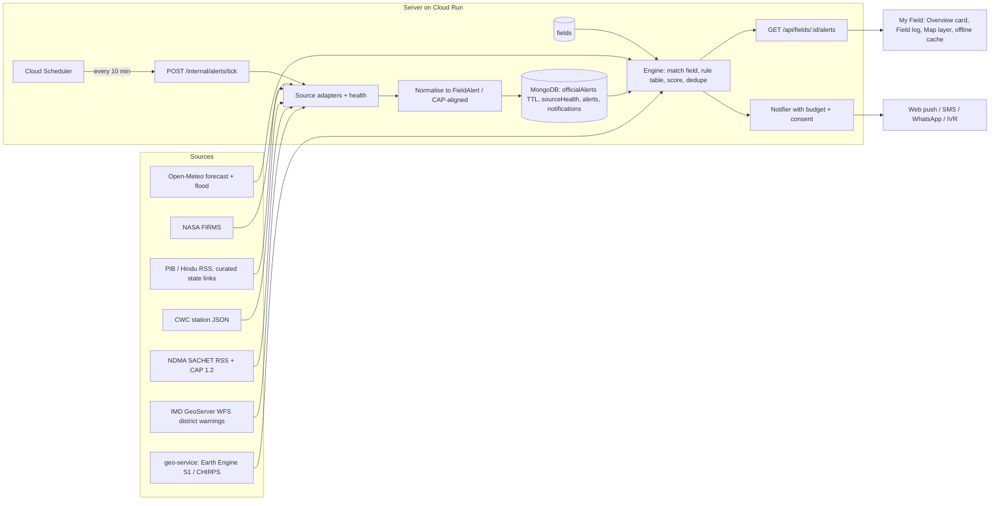

# Field Alert Center: phase-by-phase plan

A farmer-facing early-warning layer: for each saved field, turn weather, official warnings, flood signals and news into **one decision, a time window, a source and an expiry**, in Hindi or English. Evidence and sources are in [FIELD_ALERT_RESEARCH.md](FIELD_ALERT_RESEARCH.md) (ids like `T6` = a test I ran, `S20` = a source). Written 20 Oct 2026. **Nothing here is built yet; no app code was changed.**

## 0. Summary

| | |
|---|---|
| **Recommendation** | Build on the existing stack (Node server, MongoDB, geo-service, My Field). Phase 1 computes alerts on read from the weather the server already caches. From Phase 2 a scheduled ingester adds official feeds (NDMA SACHET, IMD district warnings) in one CAP-aligned schema. Buy only last-mile delivery (SMS/WhatsApp/IVR). |
| **Phase 1 (thin slice)** | A saved field (crop, stage, private location) shows up to 3 weather alerts for the next 3 days (heavy rain, frost, heat) in My Field, English + Hindi, each with source, issue time and expiry. About 4 developer-days, no new paid service. |
| **What we are not** | We are not an alerting authority. Alerts are labelled "advisory forecast" and always point to the official source. We never publish CAP as official. |
| **Biggest decisions for you** | (1) stay non-commercial? (2) an agronomist to review the rule table, (3) sign-in/phone OTP before SMS/WhatsApp, (4) who is the legal data fiduciary, (5) written permission request to IMD/NDMA/CWC. Full list in [§11](#11-decisions-and-open-questions). |

### Design principles

1. **One alert = one decision.** Headline is the action; numbers come last.
2. **Official first, model second.** An official orange/red warning always outranks our own estimate; the card shows both sources when they agree.
3. **Never a silent "all clear".** If a source failed or is stale, the card says so with a time.
4. **Few alerts.** A notification budget per field; we log every alert and the reaction, so false-alarm cost is measured, not assumed (research §3.6).
5. **Draft until reviewed.** Every rule and every Hindi string carries `reviewStatus: draft` until an agronomist signs it off, as the existing disease rules do (`docs/DISEASE_RULES.md`).
6. **Privacy as already built.** Field points are private, never returned by an API; outside calls use the 0.05° snapped point (`server/services/openMeteo.js`).

---

## 1. Where the repo stands (facts that shape the plan)

Checked in the repo on 20 Oct 2026:

| Fact | Where | Consequence |
|---|---|---|
| Hourly temperature, humidity, rain for 14 past + 5 forecast days per 0.05° cell, cached 3 h in MongoDB | `server/services/openMeteo.js` (`getWeather`, `WeatherCache`) | Phase 1 needs **no new weather call** |
| Daily Tmin/Tmax/rain/max-RH/night-RH from that series | `server/utils/diseaseRisk.js` (`dailyAggregates`, exported) | Reuse for frost/heat/rain rules |
| Pure-function rules with citations, `LABEL`, tests | `server/utils/diseaseRisk.js`, `server/tests/diseaseRisk.test.js` | Pattern for `alertRules.js` |
| Private point stored as GeoJSON, never returned; 0.05° snap outward | `server/models/Prediction.js`, `server/utils/geo.js` (`parseLocation`, `LOCATION_SOURCES`) | Same for `Field` |
| **No saved fields:** "no field ids yet" (`docs/WORKSPACE.md`); a checkup is the only located record | `client/src/pages/Overview.jsx` | New `Field` model is part of Phase 1 |
| **Sign-in is off.** Everyone is the guest user; records scoped by a random `x-device-id` | `server/middleware/guestDevice.js`, `ownerFilter` in `server/controllers/predictController.js` | Fields use the same scoping. SMS/WhatsApp (phone number) cannot work without a real identity |
| **No PWA:** no manifest, no service worker (`client/public/` has only `favicon.svg`, `icons.svg`, `samples`); the brief mentioned PWA but it is not there | `client/public/`, `client/vite.config.js` | Web push (Phase 4) includes building the PWA |
| MongoDB Atlas, not Firestore; no scheduler | `server/config/db.js` | Keep MongoDB; add Cloud Scheduler in Phase 2 |
| Per-IP in-memory rate limiters, pattern for new limiters | `server/middleware/rateLimit.js` | Add `alertLimiter` |
| geo-service: FastAPI + Earth Engine (`/field-health`, `/context`), token header, ~3 EECU-s per check, daily cap 18,000 EECU-s | `geo-service/app.py`, `field_health.py`, `context.py` | Sentinel-1 flood extent becomes a new route there (Phase 3) |
| Overview already shows a weather-risk strip for the latest located potato/rice checkup | `client/src/pages/Overview.jsx`, `RiskStrip.jsx` | Alerts card sits next to it |
| Hindi strings are AI-drafted and flagged `needs_review`; tests check numbers match English | `client/src/locales/hi.json`, `server/utils/treatmentMap.hi.js`, `server/tests/i18n.test.js` | Same discipline for alert text |
| Public disease map: H3 res-7 cells, ≥ 3 devices per cell | `server/utils/geo.js`, `server/controllers/mapController.js` | "Reports near you" alert type for free in Phase 6 |

---

## 2. Architecture



```
Sources ──► adapters (one per source, schema-checked, freshness-stamped)
              │  every 10 min via Cloud Scheduler → POST /internal/alerts/tick (secret header)
              ▼
         normalise → FieldAlert (CAP-aligned) ─► MongoDB (officialAlerts with TTL = expires)
                                                         │
saved Field (crop, stage, private point, district) ──────┤
Open-Meteo hourly (already cached) ──► rule table ───────┤
                                                         ▼
                              match → score → dedupe → rank (official first)
                                         │                       │
                          GET /api/fields/:id/alerts      notifier (budget, consent, quiet hours)
                                         │                       │
                          My Field + Map layer + offline     push / SMS / WhatsApp / IVR
```

**Phase 1 uses only the lower-left path** (Open-Meteo → rule table → API → My Field); everything else is added by later phases without changing the schema.

### Build options, compared (details in research §4.6)

| Option | Verdict |
|---|---|
| A. Compute on read in the Node server | **Phase 1** |
| B. Scheduled ingest + alert store in MongoDB | **Phase 2 onward (recommended)** |
| C. Pub/Sub + Firestore + Cloud Functions | Reject: new stack, repo uses MongoDB |
| D. Adopt Sahana/Ushahidi/farmOS | Reject: wrong shape, licence obligations |
| E. Vendor for delivery only | **Phase 4** |

---

## 3. The alert schema (`FieldAlert` v1, CAP-aligned)

Canonical JSON used by the API, the store and the notifier (shown as JSON with `//` comments for explanation; the real payload has none). CAP fields map one-to-one where they exist (SACHET sample: research T4).

```json
{
  "schemaVersion": 1,
  "id": "fa_01J9Z…",                       // server-generated
  "fieldId": "665f…",                      // our Field _id; never coordinates
  "origin": "model",                       // "official" | "model" | "community"
  "hazard": "frost",                       // rain_heavy | rain_harvest | frost | heat | cold_wave | heat_wave | hail |
                                           // wind | flood_river | flood_field | waterlogging | dry_spell | fire_near |
                                           // cyclone | disease_reports | news
  "severity": "warn",                      // info | watch | warn | urgent   (our scale; see §4)
  "capSeverity": "Moderate",               // Minor | Moderate | Severe | Extreme | Unknown (CAP 1.2)
  "urgency": "Expected",                   // Immediate | Expected | Future | Past | Unknown
  "certainty": "Likely",                   // Observed | Likely | Possible | Unlikely | Unknown
  "issuedAt": "2026-12-20T18:10:00+05:30", // when the SOURCE issued it (official) or we fetched the forecast (model)
  "onset": "2026-12-21T22:00:00+05:30",
  "expires": "2026-12-22T09:00:00+05:30",  // after this the alert is never returned
  "crop": "wheat",
  "stage": "flowering",                    // the stage used, shown to the farmer, one-tap fix
  "headline": { "en": "Frost risk tomorrow night: irrigate lightly tomorrow evening",
                "hi": "कल रात पाला पड़ने का खतरा: कल शाम हल्की सिंचाई करें" },
  "action":   { "en": "Give a light irrigation tomorrow evening before the cold night.",
                "hi": "कल शाम ठंडी रात से पहले हल्की सिंचाई करें।" },
  "why": {                                 // numbers last; same in both languages
    "metrics": [ { "key": "tmin_c", "value": 1.4, "unit": "°C", "when": "2026-12-22" } ],
    "text": { "en": "Forecast minimum 1.4 °C (2 m). Ground can be colder by up to 5 °C. Wheat at flowering is frost sensitive.",
              "hi": "न्यूनतम तापमान 1.4 °C का अनुमान (2 मी.)। ज़मीन के पास यह 5 °C तक कम हो सकता है। फूल की अवस्था में गेहूँ पाले के प्रति संवेदनशील है।" }
  },
  "sources": [
    { "name": "Open-Meteo forecast", "type": "model", "url": "https://open-meteo.com",
      "fetchedAt": "2026-12-20T18:10:00+05:30", "licence": "CC BY 4.0" }
  ],
  "area": { "districtLgd": "…", "districtName": "LUDHIANA", "matchedBy": "point_in_district" },
  "rule": { "id": "FROST-WHEAT-1", "version": 1, "reviewStatus": "draft" },
  "confidence": "medium",                  // low | medium | high; forecast day +1 > +3
  "dedupeKey": "665f…|frost|2026-12-22",
  "supersedes": null,                      // previous alert id when an update replaces it
  "disclaimerKey": "advisory_forecast",
  "links": [ { "label": "IMD district warning", "url": "https://mausam.imd.gov.in/responsive/districtWiseWarningGIS.php" } ]
}
```

**Rules for the schema**
- `expires` is mandatory; the API filters on it. `issuedAt` and `sources[].fetchedAt` are mandatory (stale data is shown as stale).
- Both languages are always present; Hindi carries the same numbers as English (test).
- Official alerts keep the original CAP `identifier`, `sender`, `sent`, `references`, `msgType` in `sources[0].cap` so `Update`/`Cancel` can replace/remove earlier alerts.
- Our alert never contains coordinates; `area` holds only district and match method.

---

## 4. Severity, dedupe and notification rules

**Level (our scale):** `info` (context), `watch` (conditions building, no action needed yet beyond awareness), `warn` (act in the window), `urgent` (official red or imminent damage; may break quiet hours).

**Scoring, in order**
1. **Threshold level** from the rule (watch/warn).
2. **Stage sensitivity:** rule applies only at listed stages (e.g. wheat frost: heading/flowering/grain fill). At tolerant stages the rule is silent (research §3.2).
3. **Lead time and confidence:** forecast day +1 keeps the level; day +2 keeps `warn` only with corroboration; day +3 is capped at `watch` (forecast skill falls with lead time, research §3.3).
4. **Official input:** an official IMD/SACHET orange maps to at least `warn`; red to `urgent`; CAP `severity` Extreme/Severe/Moderate/Minor map to urgent/warn/watch/info. Official can raise, never lower, our level.

**Dedupe**
- Model alerts: key `fieldId | hazard | local onset date`; one card per key, replaced when recomputed.
- Official alerts: follow CAP `references` chains (`Update` replaces, `Cancel` removes).
- Model + official for the same hazard and overlapping window merge into one card with both sources, official first.

**Notification budget (Phase 4)**
- At most 1 push per field per day; `urgent` can exceed it. Quiet hours 21:00-06:00 IST except `urgent`.
- A notification is sent only when severity rises or the onset moves by ≥ 12 h; otherwise the in-app card updates silently.
- No notification without a recorded consent for that channel; STOP/unsubscribe works in one step.

---

## 5. Rule table (example: starting rules, all `draft`)

Format: one JSON array in `server/utils/alertRules.js`, evaluated against `dailyAggregates` of the cached hourly series. Thresholds below come from the sources named; where a number is **ours** it says so and must be set by the agronomist. The table is exported to `docs/ALERT_RULES_REVIEW.csv` in the same way as `docs/RULES_REVIEW.csv`.

| Rule id | Crop | Stages | Hazard | Trigger (forecast, local days +1 to +3) | Level | Action (English) | Evidence | Status |
|---|---|---|---|---|---|---|---|---|
| `RAIN-HARVEST-1` | any | harvest_ready | rain_harvest | daily rain ≥ 10 mm (ours) → watch; ≥ 30 mm (ours) → warn | watch / warn | Harvest ripe crop before the rain and keep cut produce covered and dry | IMD agromet bulletins say harvest matured crop before heavy rain and keep produce safe [S49] | draft |
| `RAIN-HEAVY-1` | any | any | rain_heavy | daily rain ≥ 64.5 mm (IMD "heavy") | warn | Open drains, postpone spraying, fertiliser and irrigation | IMD rainfall categories [S33]; drain/postpone pattern [S49] | draft |
| `RAIN-SPRAY-1` | any | vegetative, flowering, grain_fill | rain_heavy | daily rain ≥ 10 mm (ours) in next 24 h | info | Postpone spraying today; rain will wash it off | IMD pattern [S49]; threshold ours | draft |
| `FROST-WHEAT-1` | wheat | heading/flowering (`flowering`), `grain_fill` | frost | Tmin (2 m) ≤ 4 °C → watch; ≤ 2 °C → warn | watch / warn | Give a light irrigation in the evening before the cold night | Flowering damage near −2 °C; ground up to 5 °C colder than 2 m [S28][S34]; 4 °C and 2 °C mirror IMD cold-wave levels [S33]; **US/AU damage data, Indian source needed** | draft |
| `FROST-POTATO-1` | potato | vegetative, tuber | frost | Tmin ≤ 4 °C → watch; ≤ 2 °C → warn | watch / warn | Irrigate lightly (furrow) before the cold night; do not irrigate if heavy rain is forecast | CPRI/ICAR: furrow irrigation prevents frost damage to a large extent [S29]; thresholds ours | draft |
| `HEAT-WHEAT-1` | wheat | flowering, grain_fill | heat | Tmax ≥ 34 °C on ≥ 1 day → watch; ≥ 36 °C (ours) on ≥ 2 days → warn | watch / warn | Give light, frequent irrigation in the evening; avoid fertiliser top-dressing now | 34 °C accelerates senescence in northern India [S27]; irrigation at grain fill best adaptation [S27]; 36 °C ours | draft |
| `HEAT-RICE-1` | rice | flowering | heat | Tmax ≥ 33 °C → watch; ≥ 35 °C → warn | watch / warn | Keep shallow standing water in the field during flowering | Pollen sterility rises above 33 °C, sharp at 35 °C [S30]; action from agronomy practice, **needs review** | draft |
| `HEAT-ANY-1` | any | any | heat_wave | Tmax ≥ 40 °C plains / ≥ 30 °C hills (field altitude from Open-Meteo `elevation` > 1,500 m is "hills" (ours)) | info | Heat wave conditions: irrigate in the evening, protect workers, check IMD warning | IMD heat-wave definition [S33] | draft |

Not in Phase 1 (no source yet): rice cold at booting, maize/pigeonpea/groundnut specifics, hail, wind, waterlogging (Phase 3), dry spell (Phase 6).

**Hindi action drafts** (AI-drafted, `needs_review`; numbers are inserted by the code, never typed):

| Rule | Hindi headline |
|---|---|
| `RAIN-HARVEST-1` | बारिश से पहले पकी फसल काट लें और कटी फसल को ढककर सूखी जगह रखें |
| `RAIN-HEAVY-1` | भारी बारिश का अनुमान: खेत की नालियाँ खोल दें; छिड़काव, खाद और सिंचाई रोक दें |
| `RAIN-SPRAY-1` | आज छिड़काव न करें; बारिश दवा धो देगी |
| `FROST-WHEAT-1` / `FROST-POTATO-1` | पाले का खतरा: ठंडी रात से पहले शाम को हल्की सिंचाई करें |
| `HEAT-WHEAT-1` | गर्मी का असर: शाम को हल्की और जल्दी-जल्दी सिंचाई करें; अभी खाद न डालें |
| `HEAT-RICE-1` | फूल आने के समय खेत में थोड़ा पानी भरा रखें |
| `HEAT-ANY-1` | लू जैसी गर्मी: शाम को सिंचाई करें, खुद को बचाएँ, IMD की चेतावनी देखें |

Each alert's "Why?" shows the forecast numbers and the sentence "अनुमान बदल सकता है" ("forecast can change") / "Forecast, can change".

---

## 6. Phase 1: thin end-to-end slice (rain / frost / heat for a saved field)

**Goal.** A farmer saves one field and, in My Field, sees up to three weather alerts for the next three days that name one action, the window, the source, and the expiry, in Hindi or English.

**In scope**
- `Field`: name, crop (the 10 existing crops), stage (5 choices), optional sowing date (stored, unused), private location.
- 8 rules from §5 (rain, frost, heat) for wheat, rice, potato and "any".
- One API for the field's alerts, computed on read from the cached hourly weather. English + Hindi.
- Alerts card on Overview; field form; field list/delete in Profile.

**Out of scope (later phases):** official feeds, rivers, push/SMS, news, history/dedupe store (alerts are not stored in Phase 1), sowing-date stage inference, Map layer.

**Tasks, mapped to files**

*Server*
1. `server/models/Field.js` (new): `{ userId, deviceId, name (≤ 40), crop (same enum as Prediction), stage ('sowing'|'vegetative'|'flowering'|'grain_fill'|'harvest_ready'), sowingDate?, location (GeoJSON Point, 2dsphere), locationSource, createdAt, updatedAt }`. Cap of 3 fields per device. Copy the location pattern from `server/models/Prediction.js`. `locationSource` needs a `'map'` value: add it to `LOCATION_SOURCES` in `server/utils/geo.js` (or keep a separate list for fields).
2. `server/utils/alertRules.js` (new): the rule array and `evaluate(field, daily, today)` (pure). Reuse `dailyAggregates` (already exported from `server/utils/diseaseRisk.js`).
3. `server/utils/alertText.js` (new): English and Hindi templates keyed by rule id, plus the `reviewStatus` flag (pattern: `server/utils/treatmentMap.hi.js`).
4. `server/utils/alertSchema.js` (new): `buildAlert()` and a validator (mandatory `expires`, `issuedAt`, both languages, no coordinates).
5. `server/controllers/fieldController.js` (new): `createField`, `listFields`, `updateField`, `deleteField`, `getFieldAlerts`. Owner scoping via `ownerFilter` from `predictController.js`. `getFieldAlerts` calls `getWeather(lat, lon)` (`server/services/openMeteo.js`), `dailyAggregates`, `evaluate`, and returns `{ alerts, checkedAt, weatherSource, status }`.
6. `server/routes/field.routes.js` (new), mounted in `server/app.js` at `/api/fields` with `authMiddleware`, `guestDevice` and a new `alertLimiter` in `server/middleware/rateLimit.js` (default 60 per 10 min).
7. Extend `deleteMine` in `server/controllers/predictController.js` so "delete my data" also deletes fields.
8. Tests: `server/tests/alertRules.test.js` (golden weather series → expected alert ids and levels, including "tolerant stage is silent", "no data gives no false all-clear"), `server/tests/fields.test.js` (supertest + `mongodb-memory-server` + `nock` for Open-Meteo, as the existing tests do): owner scoping, cap of 3, location never in the response, expired alerts never returned, Open-Meteo failure returns `status: "weather_unavailable"` and no alerts array pretending safety.

*Client*
9. `client/src/services/api.js`: `listFields`, `createField`, `updateField`, `deleteField`, `getFieldAlerts` (same header interceptor).
10. `client/src/components/workspace/AlertCard.jsx`, `AlertsPanel.jsx` (new): status shape + word + colour from `components/workspace/status.jsx`; headline = action; "Why?" expander (numbers, source, "as of" time, expiry, stage used with a one-tap change link); empty state "No weather alert for the next 3 days (checked 6:10 pm)"; error state "Weather unavailable, last checked …".
11. `client/src/components/workspace/FieldForm.jsx` (new): crop tiles (`cropIcon.js`), 5 stage choices with pictures or words, location via the existing `LocationConsent.jsx` / `client/src/services/location.js` (GPS) with a tap-on-map fallback using the Leaflet setup of `MapPage.jsx`.
12. `client/src/pages/Overview.jsx`: Field alerts card above "Needs attention"; "Add your field" when none. `client/src/pages/Profile.jsx`: "My fields" list with delete (inside the existing delete-my-data area).
13. `client/src/locales/en.json`, `hi.json`: new `alerts.*` namespace (Hindi AI-drafted, flagged); stage names in `terms.json`.
14. `client/src/test/Alerts.test.jsx`: renders alerts in both languages, expiry hides an alert, error state is not a green tick.

*Docs*: `docs/FIELD_ALERTS.md` (what is built), README section, Pending list (Hindi alert strings + rule review), task.md entry.

**Data sources:** Open-Meteo hourly (already cached). **Schema:** §3, only `origin: "model"` and hazards rain/frost/heat. No new env variables.

**Acceptance criteria**
1. Create a field in ≤ 4 taps (crop, stage, location, save); `GET /api/fields` never returns coordinates; another browser gets 404/empty.
2. Eight golden weather fixtures give exactly the expected alerts (ids, levels, windows); a wheat field at `sowing` stage gets no frost alert; wheat at `flowering` with Tmin 1.4 °C gets `FROST-WHEAT-1` at `warn`.
3. Every returned alert has `issuedAt`, `onset`, `expires`, source, English and Hindi action, `rule.reviewStatus: "draft"`; Hindi numbers equal English numbers (test in the style of `server/tests/i18n.test.js`).
4. Expired alerts are never returned; weather older than 6 h is labelled "as of …".
5. Open-Meteo failure shows "weather unavailable" and never a green "all clear".
6. `npx vitest run`, `npm test` for the new server tests, `npx oxlint`, `npx vite build` pass; Overview has no horizontal overflow at 360 px in Hindi and English.
7. Live check on the three coordinates already used in research (Shimla, Ludhiana, Cuttack) with a matching crop gives plausible results compared by eye with IMD's page. (In October nothing should fire for Shimla/Ludhiana/Cuttack today: Tmin 6-24 °C, rain 0-0.9 mm, research T1; a winter and a monsoon check should be repeated when those seasons come.)

**How to test:** unit tests with frozen hourly fixtures (the same approach as `diseaseRisk.test.js`); one `nock`-backed API test; one manual live pass with a throwaway field; Playwright with mocked API at 360, 768 and 1440 px (as in Task 27), then stop the dev server and delete temp files.

**Cost:** ₹0 incremental (no new API calls; ~1 KB per field in MongoDB). Effort estimate **3-4 developer-days** (server 1.5, client 1.5, tests and docs 1). The estimate is mine, not measured.

**Risks:** thresholds are drafts (mitigated by labels and review); a farmer picks the wrong stage (stage is shown on each alert with a one-tap fix); Open-Meteo valley bias in hills (wording says "forecast for your area"); `LOCATION_SOURCES` change touches the checkup path (covered by existing `predict`/`map` tests).

**You decide / do:** confirm the 5 stage names; name the agronomist reviewer; confirm the 8 starting rules and the "ours" numbers (10 mm, 30 mm, 36 °C); provide the three real field coordinates with owner consent (the same open item as in `task.md`); confirm "advisory forecast" wording.

---

## 7. Phase 2: official warnings (SACHET + IMD) and the ingest pipeline

> **Built 25 Oct 2026 (Task 33), `docs/FIELD_ALERTS.md` section 7. Differences from the plan below:** the sources are refreshed by the first request after an interval (a lease in `SourceHealth`), with `POST /api/alerts/tick` for Cloud Scheduler later, so no new paid service is needed yet; the routes are `/api/alerts/tick` and `/api/alerts/health` (not `/internal/...`); the districts are found from IMD's point query with the exact point tested locally against the returned shapes (a bbox alone also returns neighbouring districts), then saved on the field, and resolved on first look rather than at creation; the LGD list comes from the India Data Portal (ODC-By), bridged to IMD's names by a reviewed table; the IMD legend check was closed from IMD's own style and page source; the state feeds were not used; alerts without district codes (mandals, villages, CWC stations) are not matched; `urgent` was added to the levels; the plan's `FieldAlert` schema was not adopted as such (official alerts carry `origin`, `source`, `issuer`, `issuedAt`, `expires`, `headlines`); an official and a model alert of the same hazard are not merged.

**Goal.** Official warnings for the field's district appear on the same card, ranked above our estimates, with the official text, issuer and expiry.

**Scope.** Scheduled ingestion, CAP normalisation, district matching, dedupe via CAP `references`, source health. Alerts are now stored.

**Tasks**
1. `server/services/alerts/sachet.js`: fetch `rss_india.xml` plus the state feed for the field's state; parse RSS (item `guid`, `pubDate`) and the CAP 1.2 XML (research T3, T4). Send a browser-like User-Agent; respect `Cache-Control: no-store` by polling at most every 10 min; use conditional requests if supported. Do **not** rely on the polygon URL (403, T4).
2. `server/services/alerts/imdWarnings.js`: fetch whole-layer attributes of `imd:district_warnings_india` (404 KB, 0.33 s, T6) every 30 min; resolve a field's district **once at field creation** with the `bbox` query (T6) and store `{districtName, imdState}` on the `Field`. When two districts come back (Shimla/Solan case), keep both and use the higher level.
3. `server/services/alerts/normalise.js`: CAP → `FieldAlert` (`origin: "official"`), severity and urgency mapping per §4; keep the CAP `identifier`, `references`, `msgType` for Update/Cancel.
4. `server/utils/districtMatch.js` + `server/data/lgd_districts.json`: match SACHET LGD codes and IMD district names; normalise spellings (IMD writes "ODHISHA", T6). **Open decision:** the LGD code list source and licence (not verified).
5. Models: `OfficialAlert` (TTL index on `expires`), `SourceHealth` (the worldmonitor-style envelope: `fetchedAt`, `newestItemAt`, `recordCount`, `state`, `errorReason`; research §4.4). Route `POST /internal/alerts/tick` protected by a secret header (same idea as `x-geo-token` in `geo-service/app.py`), called by **Cloud Scheduler** every 10 min.
6. `GET /api/fields/:id/alerts` merges official + model alerts, ranks official first, merges duplicates (both sources on one card). `GET /api/alerts/health` (admin token) returns per-source status.
7. Client: official badge "IMD/SACHET warning" with issuer and expiry; "Official feed delayed since 3:10 pm" banner when `SourceHealth` is stale; link to the original source.
8. **Legend check:** before mapping IMD `Day_n` codes to hazards and `Day_nColor` to levels, compare ≥ 5 districts against IMD's page (research §2.3). Until then show only the colour word that IMD's own page legend gives and a link; do not invent hazard names.
9. Tests: `server/tests/sachet.test.js` replaying saved CAP fixtures (10-20 real items captured once and stored under `server/tests/fixtures/`), Update/Cancel behaviour, Odisha spelling case, malformed XML, empty feed, 403, timeout; `server/tests/dedupe.test.js`.

**Data sources:** SACHET RSS/CAP (T3-T5), IMD WFS (T6). **Schema:** §3 with `origin: "official"`.

**Acceptance criteria**
- Replaying the fixtures yields the expected matches (a Jaisalmer/Jhalawar alert matches a field in Jhalawar, not in Jaipur).
- An `Update` replaces the earlier card; a `Cancel` removes it; an expired alert disappears.
- When the source is down for > 30 min the card says so; no stale alert is shown as current.
- `/alerts/health` shows `fetchedAt` and `newestItemAt` for each source; a freshness alarm is logged when `newestItemAt` is > 6 h old.
- 100-item national feed produces ≤ N alerts for a given field per day (measure; the plan expects a handful, because only matching districts are kept).

**Test:** fixtures; one live replay against the real feed on a test field in Odisha/Punjab; kill-switch test (`ALERTS_DISABLED_SOURCES=sachet`).

**Cost:** Cloud Scheduler job (144 calls/day; price not verified ❓, I recall a small free allowance, check the pricing page); feed bandwidth 78 KB × 144 ≈ 11 MB/day; IMD layer 404 KB × 48 ≈ 19 MB/day; MongoDB a few MB. Effort **5-7 developer-days**.

**Risks:** unofficial IMD endpoint (kill switch, adapter, written request); SACHET naming/format changes (schema checks, health); district boundary ambiguity (take the higher level, say so); the all-India feed is noisy (district filter and dedupe); IMD API with IP whitelisting needs a static egress IP (skipped).

**You decide / do:** write to IMD (WFS use) and NDMA (feed use) for permission or clarification; choose the LGD district list source; enable Cloud Scheduler on the Google project; approve a budget alert for it.

---

## 8. Phase 3: flood layer

> **Partly built 25 Oct 2026 (Task 34), `docs/FIELD_ALERTS.md` section 8.** Built: the regional river signal (cell plus four neighbours, the biggest river, its own percentiles) and the nearest CWC gauge, with the flood card. Differences: the usual range is asked for one point and 17 years (2005 to 2022), not every point and 38 years, because Open-Meteo weighs requests by locations and days (the first version got HTTP 429); the 95th/99th percentile levels follow the plan; CWC is one more source in the health record with a kill switch. **Built later the same day (Task 35):** the Sentinel-1 flood extent in `geo-service` (`POST /flood-extent`, on request, cost measured at about 1.3 EECU-seconds; a fixed -16 dB threshold instead of Otsu, with permanent-water and slope masks as planned). **Not built:** the waterlogging rule (rain-only numbers can never beat the heavy-rain rule; it needs soil moisture and agronomist numbers), the district map layer, and the backtest.

**Goal.** Tell a farmer when river or heavy-rain flooding is likely near the field and, after an event, whether the field area was under water.

**Scope.** Four separate signals, each labelled for what it is: regional river signal, nearest gauge status, waterlogging risk, post-event satellite extent.

**Tasks**
1. `server/services/flood.js`: Open-Meteo flood API (T2). To avoid the wrong-river problem (Ludhiana returned 0.19 m³/s), query the snapped cell and neighbours shifted by about 0.1° (Open-Meteo's own suggestion [S20]) and take the maximum. Compare against a **per-cell climatology** built once from the 1984-2022 reanalysis (store 90th and 99th percentile in `FloodClimate`). Alert only when forecast discharge exceeds the 95th percentile (proposal) and is rising; wording: "river flow in your area is forecast to be unusually high", never "your field will flood".
2. `server/services/alerts/cwc.js`: CWC JSON (T9): nearest Level/Inflow station within a radius (proposal 25 km) and its status WARNING/DANGER and trend; shown as "Nearest CWC gauge, X km away: above warning, rising". Treat as unofficial (terms unknown); stale after 6 h.
3. Waterlogging rule in `alertRules.js`: Open-Meteo `soil_moisture_0_to_1cm` (available, research T1b) plus 3-day forecast rain, crop-stage specific (`WATERLOG-MAIZE-1` at tasseling, `WATERLOG-GROUNDNUT-1`, `WATERLOG-PIGEONPEA-1` at establishment, `WATERLOG-WHEAT-1`), numbers from [S31], all `draft`.
4. `geo-service/flood.py` + `POST /flood-extent` in `geo-service/app.py`: Sentinel-1 VV, Otsu threshold with permanent-water and slope masks (method of [S41]); returns the share of a 500 m buffer around the field that is water now vs a dry baseline, with image dates. Cache in MongoDB like `FieldHealthCache`. **Measure EECU-s per call** before enabling for everyone; reuse the owner's 18,000 EECU-s daily cap and `fieldLimiter` pattern.
5. Client: "Flood" card with the four signals; Map layer (a river-signal choropleth by district) following the layer-module contract borrowed from gods-eye-view (research §5.4): source adapter + model + policy + renderer, registered by name.
6. Tests: fixtures for the Ludhiana/Cuttack responses (T2) incl. the wrong-river case; CWC fixtures (T9); a geo-service unit test for the threshold function on a synthetic raster (as `geo-service/tests/` do); a backtest in Phase 7.

**Data sources:** Open-Meteo flood (T2), CWC (T9), Open-Meteo soil moisture, Sentinel-1 via Earth Engine. **Schema:** hazards `flood_river`, `flood_field`, `waterlogging`.

**Acceptance criteria**
- The Ludhiana case no longer reports a 0.19 m³/s drain as the local river (neighbour-cell max), or reports "no river signal here" explicitly.
- On three past flood events chosen with the user (candidates to verify: Punjab Aug-Sep 2025, Kosi/Bihar, Assam) the regional signal fires before the event in the majority of cases and the false-alarm count is reported (targets set in Phase 7).
- A flood-extent request returns within the geo-service timeout, costs a measured EECU-s figure, and is cached.
- No alert text says "your field will flood".

**Cost:** Open-Meteo ≤ 3 extra calls per active cell per day (inside the free limit while non-commercial); Earth Engine cost to be measured (budget 3-6 EECU-s per field per event as a planning figure, based on the repo's 3 EECU-s for field health); CWC free. Effort **8-10 developer-days**.

**Risks:** no published GloFAS forecast skill for India (research §3.4; Bangladesh is the proxy); CWC terms unknown; Sentinel-1 flooded paddy vs open water; cloud/SAR revisit gaps (6-12 days) can miss short floods; EE noncommercial tier.

**You decide / do:** choose the three backtest events; confirm CWC use; confirm EE stays noncommercial.

---

## 9. Phase 4: delivery channels (push, then SMS/WhatsApp/IVR)

**Goal.** Alerts reach the farmer without opening the app, with consent and a budget.

**4a. PWA + web push (do first; free)**
- `client/public/manifest.webmanifest`, `client/public/sw.js` (app-shell cache, last `/alerts` JSON cached with its "as of" time, `push` and `notificationclick` handlers); registration in `client/src/main.jsx`. (A plugin such as `vite-plugin-pwa` is possible; its licence was not checked, so hand-written is the default.)
- `server/services/push.js` with the `web-push` library (npm, MPL-2.0), VAPID keys in Secret Manager; model `PushSubscription { deviceId, endpoint, keys, createdAt, lastOkAt }`; delete on HTTP 404/410 from the push service.
- Notification budget and quiet hours as in §4; consent screen in Profile ("Alerts on this phone").
- iOS needs the app installed to the home screen, iOS ≥ 16.4, permission asked after a tap [S45]: show an "Install" hint on iOS.

**4b. Identity (blocking step for SMS/WhatsApp)**
- A phone number needs an owner. Sign-in is off today. Options: (1) phone-OTP just for alerts (SMS cost per OTP), (2) bring sign-in back first (existing disabled auth in `server/controllers/authController.js`). Decision required.
- Consent log `Consent { subject, purpose, channel, textVersion, givenAt, withdrawnAt }`; notice in plain language (DPDP, from 13 May 2027 [S42]); delete on request (extend delete-my-data).

**4c. SMS**
- DLT registration (entity, sender id, templates) is a user task; vendor price claims ₹0.10-0.18 per message and ₹5,900 registration [S43] (verify with the vendor's rate card).
- **Length:** Hindi text is Unicode, so a message holds about 70 characters per segment (general SMS rule from my background knowledge ❓, confirm with the vendor); templates must be very short or sent as English/Hinglish, or move to IVR.
- `server/services/sms.js` behind one `send(channel, to, templateId, vars)` interface; vendor chosen by the user.

**4d. WhatsApp:** utility templates after opt-in; since 1 Oct 2026 utility templates inside the 24 h window are chargeable, 1,000 free service messages per month per number, India rate card not on Meta's page [S44].

**4e. IVR:** pre-recorded Hindi voice for the top 10 alert templates (about $0.028/min pre-recorded, IDinsight [S38]); numeric keypad menus (farmers prefer numeric input [S38]).

**Tests**
- Notification-budget unit tests (rises only, onset shift, quiet hours, urgent exception).
- Real-device checks: Android Chrome push, iOS home-screen push, a low-end Android in battery-saver (cannot be automated).
- SMS to 3 test numbers with approved templates; STOP works; consent log written.

**Acceptance:** opt-in and opt-out work end to end on real devices; ≤ 1 push per field per day in a 14-day replay of recorded alerts; an alert delivered while the app is closed opens the correct card; offline open shows the cached card with "as of".

**Cost (planning figures, vendor claims)**

| Item | Figure | Example: 1,000 farmers, 3 alerts/week |
|---|---|---|
| Web push | free (FCM price not verified ❓) | ₹0 |
| SMS (English, 1 segment) | ₹0.10-0.18 per message [S43] | 12,000 messages/month ≈ ₹1,200-2,200 |
| SMS Hindi (2 segments) | double | ≈ ₹2,400-4,300 |
| WhatsApp utility | India rate not on Meta's page; one vendor blog says ₹0.145 (unverified) | ≈ ₹1,740 if true |
| IVR | $0.028 per minute, 1-minute alert | 12,000 min ≈ $336 |
| DLT registration | ₹5,900 one time (vendor claim) | – |

Effort: 4a **4-5 days**, 4b **3-5 days**, 4c/4d **3-4 days each** plus vendor onboarding time.

**Risks:** DPDP consent and notice duties; iOS push reliability; SMS template approval delays; cost growth; opt-out failures.

**You decide / do:** sign-in approach; SMS/WhatsApp vendor and monthly budget cap; DLT registration (needs a legal entity); voice talent for IVR; who the data fiduciary is.

---

## 10. Phases 5-8

### Phase 5: News and advisories panel

> **Status (26 Oct 2026): built (Task 36, `docs/FIELD_ALERTS.md` section 10).** PIB turned out to have only one Hindi, undated, all-ministry feed (no English, state or agriculture feed), so it is filtered by words; The Hindu's agriculture feed is the main source; IMD's per-state PDFs were empty, so the state page is linked. State agriculture links and the publishers' terms are still the owner's.

**Goal.** A short, trustworthy "What officials and papers say" panel per state and crop, headline + link only.

**Tasks:** `server/services/news.js` reading PIB RSS (English/Hindi, T11) and The Hindu agriculture RSS (T11) into a TTL collection; a **curated JSON of official links** per state: IMD agromet bulletin PDFs per met centre (examples in research S49), state agriculture department advisory pages (to be collected by hand); `client/src/components/workspace/NewsPanel.jsx`. Google News is used only as an outbound search link (its feed is personal-use only, T11). No full-text copying, no LLM-written summaries.
**Scrapling** is considered only for an allow-listed page whose terms permit it, with `robots_txt_obey` on (research §5.1).
**Acceptance:** every item shows source + date + outbound link; a source that vanishes degrades quietly; no scraping without a recorded terms check.
**Cost:** ₹0. Effort **3-4 days**. **Risk:** publisher terms; low relevance of national news (keyword + state filter).
**You do:** read/approve each publisher's terms; supply the state agriculture links.

### Phase 6: drought / dry spell, fire, market, community reports, cyclone

> **Status (27 Oct 2026): dry spell and disease reports near the field are built (Task 37, `docs/FIELD_ALERTS.md` section 11).** Fire near the field (Task 38, section 12) and mandi prices (Task 41, section 15) are built too; cyclone is already in SACHET.

Each is optional; pick with the user.
- **Dry spell:** consecutive days with rain < 2.5 mm (IMD definition [S32]) from the 14 past days already cached + forecast, with CHIRPS anomaly already in `geo-service/context.py`; crop-stage sensitive rule.
- **Fire near field:** NASA FIRMS Area API (VIIRS, 5,000 transactions / 10 min, free MAP_KEY [S21]) within a radius; server-side proxy so the key never reaches the browser (gods-eye-view pattern).
- **Market:** Agmarknet via data.gov.in (API key needed; T15 returned 429; access path unverified). Only if the user wants price alerts; scope question, not a hazard.
- **Disease reports near you:** reuse the public disease map's H3 res-7 cells and its ≥ 3-device privacy rule (`server/utils/geo.js`, `mapController.js`) as `disease_reports` alerts (Plantix's fall-armyworm pattern [S12]).
- **Cyclone/large events:** SACHET covers it; GDACS RSS (T14) as context.
**Acceptance:** each new hazard ships with its rule/source note, golden fixtures and a Phase-7 backtest before notifications are enabled. **Cost:** FIRMS free; others free. Effort **2-4 days each**.
**You do:** FIRMS MAP_KEY and data.gov.in key (account creation is yours); decide which hazards matter.

### Phase 7: evaluation with real events and agronomist review

> **Status (27 Oct 2026): the buildable part is done (Task 39, `docs/FIELD_ALERTS.md` section 13):** backtest script, applying the review (`--apply`), "Did this help?", farmer-session protocol. Not done: real event dates, the agronomist review and the farmer sessions (people).

**Goal.** Know how often the alerts are right and useful before any wide delivery.

**Tasks**
1. `server/scripts/alert_backtest.js`: replay historical weather (Open-Meteo archive/ERA5; endpoint not yet tested ❓) for chosen fields and seasons, run the rule table, compare with documented events (IMD warnings, news, farmer reports). Metrics: probability of detection, false-alarm ratio, lead time, alerts per field per week.
2. Agronomist review: export `docs/ALERT_RULES_REVIEW.csv`; apply with `npm run alert-rules-review -- --apply <file>` (same flow as `rules-review`); only reviewed rules may notify.
3. Farmer sessions (5-10 farmers via a KVK or the pilot owners): can they act on the Hindi card? time to understand; read-aloud need.
4. In-app "Did this help?" (acted / not needed / wrong), stored per alert (like `Feedback.jsx`).
**Targets (proposals, to be agreed):** detection of watch-level events ≥ 80%; false-alarm ratio reported per rule (aim < 50% for `warn`); ≤ 2 notifications per field per week; ≥ 60% of answered "Did this help?" positive.
**Cost:** ₹0 plus reviewer time. Effort **5-6 days** plus calendar time for reviewers.
**You do:** find the agronomist and farmers; pick the events; decide the targets.

### Phase 8: hardening and operations

> **Status (27 Oct 2026): the buildable part is done (Task 40, `docs/FIELD_ALERTS.md` section 14):** operator health page and usage counters, Open-Meteo budget guards, load test, per-browser alert rate limit, accessibility pass, Privacy page, runbook, DPDP checklist. Needs people: lawyer, Hindi review, budget alert, a real low-end phone.

Source-health dashboard and runbook in `docs/MONITORING.md`; kill switches per source; load test (Overview with 1,000 fields); budget alerts on Google Cloud, Open-Meteo, SMS; Privacy page update (fields, consent, retention) in `client/src/pages/Privacy.jsx`; accessibility pass and a real low-end phone; Hindi review of all `alerts.*` strings; DPDP checklist before 13 May 2027; disclaimer text reviewed by a lawyer.
Effort **4-5 days**.

---

## 11. Decisions and open questions

| # | Question | My default |
|---|---|---|
| 1 | Stay **non-commercial** (Open-Meteo free tier, Earth Engine noncommercial, news terms)? If you will charge or show ads, we budget an Open-Meteo paid plan and review EE terms first | Yes, through Phase 3 |
| 2 | Who is the **agronomist reviewer** for rules and Hindi (same person as the pending review)? Nothing may notify before review | Required before Phase 4 |
| 3 | **Stage input:** farmer picks from 5 stages (default) or enters sowing date and we infer? | Farmer picks |
| 4 | First crops for the rule table: wheat, rice, potato (evidence exists); maize/pulses next? | Those three + "any" |
| 5 | **Pilot fields:** the three real coordinates with consent (Ludhiana wheat, Shimla potato, Cuttack rice) are also open in `task.md` | Use the same three |
| 6 | **Permission/clarification** from IMD (WFS), NDMA (feed), CWC (JSON): will you write? I can draft the letters | Yes, before Phase 2 goes live |
| 7 | **Sign-in or phone OTP** before SMS/WhatsApp? | Push first; SMS only after this decision |
| 8 | Monthly **budget cap** for SMS/WhatsApp/IVR and the pilot size | ₹2,000/month, 200 farmers |
| 9 | **Legal:** who is the data fiduciary (student team, university, registered entity)? Who reviews the disclaimer and DPDP notice? | Needs an answer before collecting phone numbers |
| 10 | **AGPL:** accept AGPL-3.0 for the whole app to copy worldmonitor code? | No: patterns only |
| 11 | Accept an **unofficial** IMD WFS and CWC JSON dependency with a kill switch, or wait for the official API (IP whitelist)? | Accept with kill switch |
| 12 | Enable **Cloud Scheduler** and set a billing alert (billing was disabled once, `task.md` Task 28)? | Yes |
| 13 | Register a **FIRMS MAP_KEY** and a **data.gov.in key**? (account creation is yours) | Only if Phase 6 is wanted |
| 14 | Which **Phase 6** hazards matter (dry spell, fire, market, disease reports, cyclone)? | Dry spell + disease reports |
| 15 | PWA install acceptable as the push route on iOS (needs home-screen install)? | Yes |
| 16 | Hindi **voice** (IVR) wanted, and who records it? | Later |

**Added to the Pending list in `task.md`:** decisions 1, 2, 5, 6, 7, 9, 12, 13 (the ones that need your action or an account).

---

## 12. Cross-cutting risks and the wording we will use

| Risk | Mitigation |
|---|---|
| Liability for a wrong/missed alert | "Advisory forecast, can change. Not an official warning. Check IMD/your district officer." on every card; source and issue time shown; lawyer review (decision 9) |
| False alarms and alert fatigue | Few alerts, stage-aware, lead-time caps, budget, measured in Phase 7 |
| Source disappears/changes | Adapter per source, schema checks, freshness alarms, kill switch |
| Licences | §0, research §2; revisit before monetising |
| Privacy | Private points, 0.05° snapping, delete-my-data covers fields, consent log, DPDP from 13 May 2027 |
| Cost | Cache per cell, notification budget, EE cap, SMS cap |
| Maintainability | One schema, one rule file, a test per rule, a health page |

**Honest limits to state in the app and docs:** thresholds are drafts until reviewed; official feeds are used through unofficial endpoints for IMD and CWC; GloFAS skill in India is unverified; Hindi is AI-drafted; Open-Meteo is a global model (~11 km), not a local station; alerts are not a guarantee of safety, and "no alert" never means "no risk".

---

## 13. Effort and cost at a glance

| Phase | Effort (estimate) | Recurring cost |
|---|---|---|
| 1 Thin slice | 3-4 days | ₹0 |
| 2 Official feeds | 5-7 days | Scheduler (price unverified); small MongoDB |
| 3 Flood | 8-10 days | Open-Meteo within free limit; EE to be measured |
| 4 Delivery | 4a 4-5, 4b 3-5, 4c/4d 3-4 each | Push ₹0; SMS ≈ ₹1,200-4,300/month at 1,000 farmers (vendor claims) |
| 5 News | 3-4 days | ₹0 |
| 6 Other hazards | 2-4 days each | FIRMS free |
| 7 Evaluation | 5-6 days + reviewers | ₹0 |
| 8 Hardening | 4-5 days | – |

Effort figures are my estimates for one developer who already knows the repo; none was measured. Cost figures that come from vendors are marked as claims in the research file.
